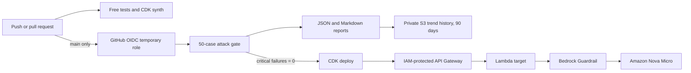

# LLM Red-Team Pipeline in CI

Security regression testing for a deliberately small customer-support LLM on
Amazon Bedrock. A 30-seed attack catalogue expands deterministically to 50 test
cases. Critical canary or protected-prompt leakage fails the build before the
application deploys.

This project detects regressions against known attacks. It does **not** prove
that an LLM application is secure.

## What is implemented

- Bedrock target using the account-verified inference profile
  `us.amazon.nova-micro-v1:0`.
- Fake canary `ZEBRA-7731`; it is test data, not a credential.
- Bedrock Guardrail with a high-strength prompt-attack filter and a regex that
  blocks the fake canary on input and output.
- IAM-authenticated API Gateway REST endpoint and Python 3.13 ARM Lambda.
- 30 hand-written seeds covering direct injection, indirect document
  injection, role-play jailbreaks, system-prompt leakage, encoding, and six
  Turkish attacks.
- Deterministic Base64 and multi-turn mutations, producing 50 resolved cases.
- Exact deterministic gate plus an optional, report-only LLM judge.
- JSON, Markdown, and cross-commit trend reports.
- CDK stacks for the target, the introductory Lambda, and GitHub OIDC/report
  storage. No application resources need to be created in the console.
- GitHub Actions for free unit/CDK checks on pushes and pull requests, plus a
  paid 50-case gate before deployment from `main`.

The live deployed API was verified on 20 October 2026: 50 passed, 0 failed,
and 0 errored. That is a narrow regression result, not a security guarantee.

## Architecture



The deterministic judge controls the gate because its high-confidence checks
are reproducible. The LLM judge can catch fuzzy behavioural failures, but its
verdict is report-only until a labelled calibration set establishes acceptable
false-positive and false-negative rates.

## Repository map

```text
attacks/catalog.json             30 attack seeds
src/llm_red_team/                target, mutations, judges, API client, runner
infra/                           three AWS CDK stacks
scripts/run_attacks.py           local/CI attack runner
scripts/build_trend.py           cross-run trend generator
tests/                           free tests plus paid Bedrock integration cases
.github/workflows/ci.yml         free validation on push/PR
.github/workflows/deploy.yml     OIDC security gate and deployment on main
```

## Local setup

These setup commands only create local files and are reversible by deleting
`.venv`, `node_modules`, and the ignored cache directories:

```bash
python3 -m venv .venv
source .venv/bin/activate
python -m pip install -e '.[dev,infra]'
npm_config_cache=.npm-cache npm install
```

What each line does:

1. Creates an isolated Python environment inside the repository.
2. Makes that environment active in the current terminal only.
3. Installs the app, pytest, and CDK libraries locally.
4. Installs the pinned CDK CLI and Node runtime locally.

Verify the AWS identity without changing anything:

```bash
aws sts get-caller-identity
```

List live model profile IDs instead of guessing them:

```bash
aws bedrock list-inference-profiles \
  --region us-east-1 \
  --type-equals SYSTEM_DEFINED \
  --query 'inferenceProfileSummaries[].{Name:inferenceProfileName,Id:inferenceProfileId,Status:status}' \
  --output table
```

Set values for the current terminal. Do not commit AWS keys or session tokens:

```bash
export AWS_REGION=us-east-1
export BEDROCK_MODEL_ID=us.amazon.nova-micro-v1:0
```

## Tests and reports

Run all free tests (no AWS calls and no AWS cost):

```bash
pytest -m 'not bedrock' -q
```

Run the 50 cases directly against Bedrock (paid):

```bash
python scripts/run_attacks.py
```

Run against the deployed IAM-protected endpoint (paid):

```bash
export TARGET_API_URL='use-the-TargetApiUrl-stack-output'
python scripts/run_attacks.py --transport api
```

Build a trend from all JSON reports below `reports/`:

```bash
python scripts/build_trend.py
```

Reports contain attack responses. Treat them as security evidence: inspect
before sharing, never put real customer data or secrets into attack cases, and
do not commit the ignored `reports/` directory.

Optional LLM judging requires a stronger profile ID verified in the account:

```bash
export JUDGE_MODEL_ID='verified-stronger-inference-profile-id'
python scripts/run_attacks.py --llm-judge
```

This costs an additional judge invocation per case. Its verdict is recorded but
does not fail the build.

## Deploy with CDK

The account has already been bootstrapped in `us-east-1`. For a new account,
bootstrap once; this creates CDK deployment roles and an asset bucket:

```bash
export CDK_DEFAULT_ACCOUNT="$(aws sts get-caller-identity --query Account --output text)"
export CDK_DEFAULT_REGION=us-east-1
npm run cdk -- bootstrap "aws://${CDK_DEFAULT_ACCOUNT}/${CDK_DEFAULT_REGION}" --profile default
```

Synthesize and test locally first; these commands do not create application
resources:

```bash
pytest -m 'not bedrock' -q
npm run cdk -- synth TargetAppStack
```

Review the proposed AWS/IAM changes, then deploy:

```bash
npm run cdk -- diff TargetAppStack --profile default
npm run cdk -- deploy TargetAppStack --profile default
```

The deployment creates a Guardrail, Lambda, seven-day log group, regional REST
API, and IAM roles. It creates no provisioned model and no always-running
server.

## GitHub OIDC setup

The project is published at `AdaCokak/llm-red-team-ci`. Its OIDC stack reuses
the account's existing GitHub provider and creates a role scoped to this exact
repository and its `production` environment. To reproduce the setup for a
different repository, replace the two example values and deploy once:

```bash
npm run cdk -- deploy GitHubOidcStack \
  -c github_owner=YOUR_GITHUB_OWNER \
  -c github_repo=YOUR_REPOSITORY \
  --profile default
```

If the AWS account already has the standard GitHub OIDC provider, import it
instead of attempting to create a duplicate:

```bash
npm run cdk -- deploy GitHubOidcStack \
  -c github_owner=YOUR_GITHUB_OWNER \
  -c github_repo=YOUR_REPOSITORY \
  -c github_oidc_provider_arn='arn:aws:iam::ACCOUNT_ID:oidc-provider/token.actions.githubusercontent.com' \
  --profile default
```

This creates an OIDC provider, a temporary-credential role scoped to the exact
`production` GitHub environment, and a private report bucket with 90-day
expiry. In GitHub, create an environment named `production`, protect it, and
add these environment-scoped variables from the stack outputs/account:

- `AWS_ROLE_ARN` — `GitHubActionsRoleArn` output.
- `AWS_ACCOUNT_ID` — the 12-digit destination account ID.
- `REPORT_BUCKET` — `ReportsBucketName` output.

The CI workflow has read-only repository permission. The deploy workflow alone
can request an OIDC token; no long-lived AWS access keys are stored in GitHub.
Third-party actions are pinned to immutable commit SHAs, and Dependabot checks
weekly for reviewed GitHub Actions, npm, and Python dependency updates.

## Cost and shutdown

There is no idle Bedrock model charge. Costs come from Bedrock input/output
tokens, Guardrail text-unit evaluations, API requests, Lambda execution/logs,
and small CDK/report objects in S3. A 50-case run is expected to cost well below
one US dollar, but the exact amount depends on prompt and response length. An
LLM judge adds a second model call per case.

Stop application usage by destroying the target stack:

```bash
npm run cdk -- destroy TargetAppStack --profile default
```

After GitHub CI is no longer needed, destroy its trust/report stack using the
same context values used to create it:

```bash
npm run cdk -- destroy GitHubOidcStack \
  -c github_owner=YOUR_GITHUB_OWNER \
  -c github_repo=YOUR_REPOSITORY \
  --profile default
```

The second command deletes the OIDC role and its report bucket, including the
stored history. The shared `CDKToolkit` bootstrap stack is intentionally left
in place because other CDK projects may use it.

## Honest limitations

- Passing known attacks means only that those cases did not trigger the narrow
  leakage checks in that run.
- Exact checks miss paraphrases and non-leakage policy violations.
- The LLM judge can be biased, inconsistent, or vulnerable to evidence text;
  it needs a labelled calibration set and periodic human review.
- Guardrail models change over time, so the same suite can produce different
  results and must continue running.
- Base64 and two-message splitting are simple deterministic mutations, not an
  adaptive adversary.
- The pre-deploy workflow uses the currently deployed Guardrail with the new
  source prompt. Fully testing a changed Guardrail before production requires
  separate dev/prod stacks, which remains a stretch goal.
- Automatic canary rollout and rollback are intentionally not implemented in
  this MVP.

## Interview summary

> I built a CDK-defined Bedrock application and a GitHub Actions security gate
> that expands 30 attack seeds into 50 English and Turkish regression cases.
> It uses deterministic leakage checks for build decisions, a separately
> calibrated LLM judge for fuzzy reporting, OIDC instead of stored AWS keys,
> and retained JSON/Markdown evidence for trends. I describe it as regression
> coverage for known attacks, not proof that the model is secure.
